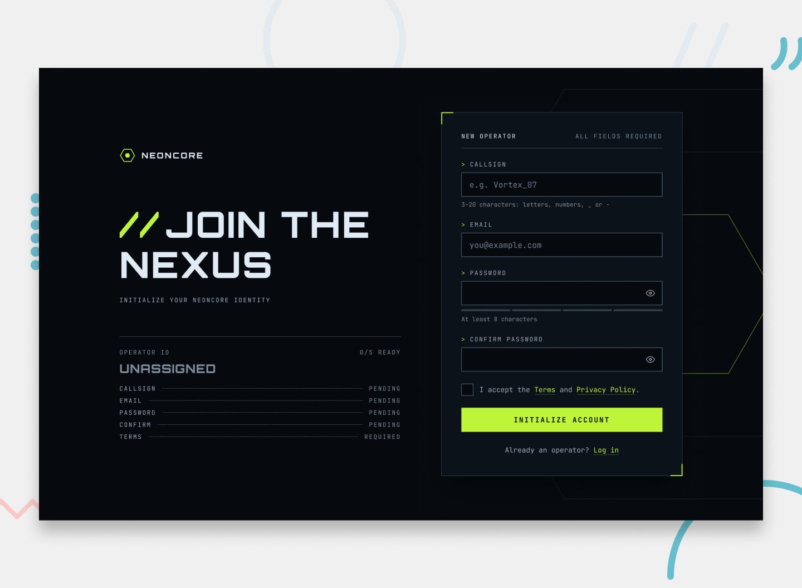

# NEONCORE Gamer Sign-up Form

A responsive gamer registration interface built with semantic HTML, CSS, and vanilla JavaScript.

## Table of contents

- [Overview](#overview)
- [Features](#features)
- [Screenshot](#screenshot)
- [Built with](#built-with)
- [Getting started](#getting-started)
- [Implementation notes](#implementation-notes)
- [Accessibility](#accessibility)
- [Author](#author)

## Overview

This project recreates the NEONCORE sign-up experience from the supplied Frontend Mentor design files. It includes a desktop operator readout, a mobile registration layout, real-time field validation, password-strength feedback, and a success state.

## Features

- Validates callsign, email, password, password confirmation, and terms acceptance.
- Shows clear field-level error messages after validation is triggered.
- Provides separate password visibility controls.
- Updates a four-level password-strength meter while the password is typed.
- Tracks completion progress in the operator readout.
- Displays a submission/loading state and a success state.
- Supports keyboard-only form completion.
- Reflows for mobile, tablet, and desktop screen widths.
- Includes visible hover, focus, valid, and invalid states.

## Screenshot



## Built with

- Semantic HTML5
- CSS custom properties
- CSS Grid and Flexbox
- Mobile-first responsive CSS
- Vanilla JavaScript
- Orbitron and JetBrains Mono local fonts

## Getting started

No build tools or package installation are required.

1. Clone the repository.
2. Open `index.html` in a browser.

For local development with automatic refresh, serve the project directory with any static server. For example, if Python is installed:

```bash
python -m http.server 8000
```

Then visit `http://localhost:8000`.

## Implementation notes

The application is contained in three core files:

- `index.html` provides the semantic page structure and form controls.
- `styles.css` implements the visual design, breakpoints, states, and local font imports.
- `script.js` handles validation, password visibility, strength scoring, progress updates, submission, and the success view.

The project is intentionally implemented without a framework or external runtime dependency.

### Validation rules

- Callsign: 3–20 characters using letters, numbers, `_`, or `-`.
- Email: a valid email address with a maximum length of 254 characters.
- Password: at least 8 characters.
- Password confirmation: must match the password.
- Terms: must be accepted before submission.

Form submission is simulated in the browser. No account data is sent to a server.

## Accessibility

- Native form labels are associated with their controls.
- Validation errors are connected to inputs with `aria-describedby`.
- Invalid fields use `aria-invalid`.
- Field, submission, and success feedback is announced through live regions.
- Password controls expose their current action and control the related input.
- The success heading receives focus after registration completes.
- Interactive elements provide visible keyboard focus styles.

## Author

- GitHub: [@afuntosinesther](https://github.com/afuntosinesther)
